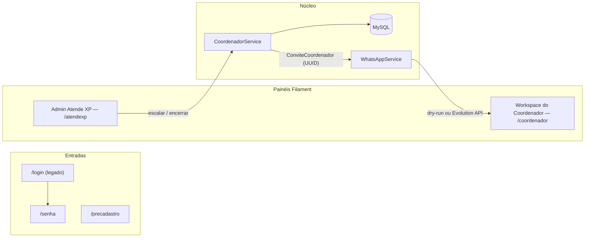
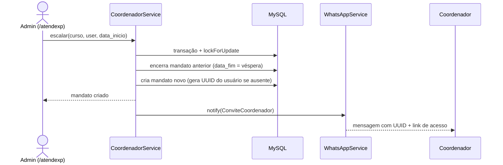

# 🎓 Atende XP — Suporte a Matrículas

**Plataforma interna da Cidade do Saber** (Prefeitura de Camaçari) para emissão
de senhas de matrícula, gestão de carteirinhas, pré-cadastro de candidatos
e coordenação de cursos.


## 📖 Sobre o projeto

O Atende XP apoia o processo de matrícula presencial da Cidade do Saber:
candidatos se pré-cadastram, recebem senhas oficiais com QR Code e, após a
matrícula, contam com carteirinha digital. A gestão dos cursos é feita por
**coordenadores com mandato definido** — cada curso pode ter vários
coordenadores ao longo do tempo, um por vez, com período de vigência
(`data_inicio` / `data_fim`) — cada um com seu **Workspace** exclusivo.

## ✨ Funcionalidades

- **Pré-cadastro de candidatos** e emissão de senhas de matrícula com QR Code
- **Carteirinhas** de acesso ao aplicativo do cursista
- **Módulo de coordenação de cursos** — mandatos com início/fim, escalação e
  encerramento com regras transacionais (um único coordenador ativo por curso,
  garantido por constraint no MySQL)
- **Dois painéis Filament**:
  - `/atendexp` — administração (cursos, coordenações, escalação de mandatos)
  - `/coordenador` — *Workspace do Coordenador*, acessível apenas a
    coordenadores com mandato ativo
- **Convite por WhatsApp** — ao ser escalado, o coordenador recebe mensagem
  com seu **UUID de acesso** e link do Workspace
- **Tema "Aurora"** — identidade visual da marca (verde/dourado), modo claro
  e escuro com design tokens

## 🧱 Stack

| Camada | Tecnologia |
|---|---|
| Backend | PHP 8.3 · Laravel 13 |
| Painéis admin | Filament v5 (multi-panel) |
| Banco | MySQL 8 (base legada + tabelas novas) |
| Front | Blade · Tailwind · Vite · tema CSS próprio |
| Mensageria | Evolution API (WhatsApp) via canal de notification próprio |
| Fila | Laravel Queue (sync em dev, database em produção) |

## 🗺️ Arquitetura em um minuto



**Fluxo de escalação de coordenador:**



A regra de negócio de coordenação mora **num único lugar** —
`App\Services\CoordenadorService` — consumido pelas actions do Filament.

## 🚀 Instalação

**Pré-requisitos:** PHP 8.3+ (extensões `pdo_mysql mbstring xml curl zip intl gd`),
Composer, MySQL 8, Node 20+.

```bash
git clone https://github.com/leonardolucena261/atendexp_suporte.git
cd atendexp_suporte

composer install
cp .env.example .env
php artisan key:generate

# crie o banco e configure as credenciais no .env antes de migrar
php artisan migrate

npm install
npm run build

php artisan serve   # http://127.0.0.1:8000
```

## 🔑 Variáveis de ambiente

| Variável | Descrição |
|---|---|
| `DB_*` | Conexão MySQL (base legada + novas tabelas) |
| `WHATSAPP_ENABLED` | `false` = **modo seco** (só registra no log) · `true` = envia de verdade |
| `WHATSAPP_BASE_URL` | URL da instância Evolution API |
| `WHATSAPP_API_KEY` | Chave da API (nunca versionada) |
| `WHATSAPP_INSTANCE` | Nome da instância WhatsApp |

## 🚪 Acessos e papéis

| URL | Quem | O que faz |
|---|---|---|
| `/login` → `/senha` | Todos (auth legada) | Login do sistema |
| `/precadastro` | Candidatos | Pré-cadastro de matrícula |
| `/atendexp` | Administradores (`is_admin`) | CRUD de cursos e escalação de coordenadores |
| `/coordenador` | Coordenadores com mandato ativo | Workspace do Coordenador |
| `/coordenador/acesso/{uuid}` | Coordenadores convidados | Acesso via UUID + senha *(em desenvolvimento)* |

## 🗂️ Estrutura essencial

```
app/
├── Channels/WhatsappChannel.php          # ponte notification → WhatsApp
├── Filament/
│   ├── Coordenador/Resources/Cursos/     # resource compartilhado entre painéis
│   └── Providers/                        # AtendexpPanelProvider · CoordenadorPanelProvider
├── Models/                               # Curso, CursoCoordenador, Coordenacao, Diretoria, User
├── Notifications/ConviteCoordenador.php
└── Services/
    ├── CoordenadorService.php            # regra de negócio dos mandatos
    └── WhatsAppService.php               # transporte WhatsApp (dry-run nativo)
```

## 🧪 Testes

```bash
php artisan test
```

## 🗺️ Roadmap

- [ ] Rota de acesso ao Workspace por UUID + senha (`/coordenador/acesso/{uuid}`)
- [ ] Backfill de UUIDs para usuários existentes
- [ ] Suíte de testes do fluxo de escalação
- [ ] Confirmação de pré-cadastro por WhatsApp
- [ ] Lembretes agendados (dia da matrícula, digest do coordenador)
- [ ] Convocação de lista de espera

## 🔐 Segurança

- `.env` e credenciais **nunca** são versionadas
- Acesso a painéis negado por padrão (`FilamentUser::canAccessPanel` por painel)
- WhatsApp apenas **transacional**, com opt-in do usuário (LGPD)
- UUID do coordenador é *identificador* de acesso, não segredo — a senha é a do usuário

## 👤 Autor

**Leonardo Lucena** — [@leonardolucena261](https://github.com/leonardolucena261)

Projeto de uso interno da **Cidade do Saber — Prefeitura de Camaçari**.
Todos os direitos reservados.